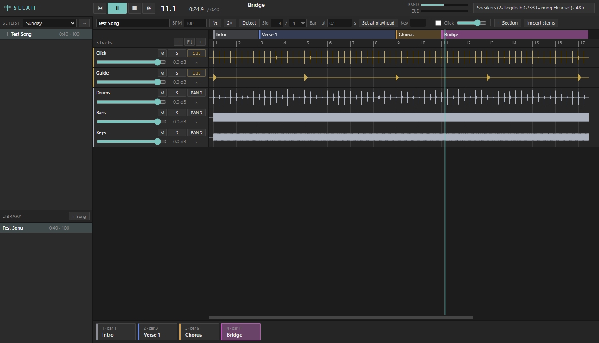

# Selah

[](https://github.com/Shanetabr/selah/actions/workflows/test.yml)
[](https://github.com/Shanetabr/selah/releases/latest)

[](LICENSE)

**Multitrack playback for live shows, built to replace Ableton on stage.**

Bands, theatre crews and worship teams commonly run backing tracks, click
and spoken guide cues from Ableton Live. That works, but it's a full DAW that
one wrong click can derail mid-show. Selah does just that job. Import a
song's stems, set its
tempo, mark its sections, send click and guide to the in-ears and the band
tracks to the mains, then jump between sections on the bar line with a
spoken count-in.



## Highlights

- **Section jumps that land on the bar.** Tap *Chorus* (or press a number
  key, or just say "chorus") and Selah counts it in, "Chorus 2 3 4", in the
  band's ears, then crossfades onto the next downbeat.
- **A spoken guide that follows the arrangement.** Section names and
  count-ins are generated from the section markers, so they stay right after
  a jump or a tempo change. A pre-recorded guide stem can't do that.
- **Imports what teams already have.** Folders of stems, loose stems, the
  MIDI cue clips from existing Ableton sets (tempo, time signature, sections
  and callouts come along), PDF lead sheets, and setlists from
  Planning Center.
- **Tempo from the click stem.** Selah reads BPM, bar 1 and the time
  signature from a recorded click.
- **Map mode.** Tap section names as the song plays to record its structure.
- **Routing for real rigs.** Two feeds (in-ears / front of house) on any
  outputs, or separate channels for a Dante desk: click, guide and named
  stem groups each on their own output.
- **LIVE mode.** Locks editing during a show and makes the pads and
  readouts bigger.
- **Voice control, on device.** A small keyword-spotting model (sherpa-onnx)
  listens for section names. Nothing is sent anywhere.

## How it works

```
┌─────────────────────────┐   IPC    ┌───────────────────────────────┐
│ Renderer (window)       │◄────────►│ Main process                  │
│ timeline, pads, mixer,  │          │ library, import, keys,        │
│ setlist, chart review   │          │ Planning Center               │
│ mic → AudioWorklet      │          └──┬──────────┬──────────┬──────┘
└─────────────────────────┘             │          │          │
                         utility process│          │          │ child process
                   ┌────────────────────▼─┐  ┌─────▼────────┐ ┌▼──────────────┐
                   │ Audio engine         │  │ Voice        │ │ PDF chart     │
                   │ mixer · click · cues │  │ sherpa-onnx  │ │ reader        │
                   │ → RtAudio (CoreAudio,│  │ keyword      │ │ (pdf.js)      │
                   │   ASIO, WASAPI)      │  │ spotter      │ └───────────────┘
                   └──────────────────────┘  └──────────────┘
```

- **The audio engine runs in its own process**, so UI work can never stall
  playback. Every track plays from one shared sample counter, so stems can't
  drift apart. A jump is scheduled at a sample position on the bar line.
- **The music logic is plain, tested functions.** Tempo grid
  ([`grid.js`](src/shared/grid.js)), cue placement
  ([`cues.js`](src/engine/cues.js)), section editing
  ([`structure.js`](src/shared/structure.js)) and click-stem analysis
  ([`clicktrack.js`](src/shared/clicktrack.js)) are pure modules shared by
  the engine and the UI.
- **Voice control** spells each section name in the model's own sound pieces
  ([`spell.js`](src/voice/spell.js)). The unit tests run the spotter on the
  guide voice's own recordings.
- **Stems are never modified.** Decoded audio is cached beside a single
  `library.json` and can always be rebuilt from the originals.

Built with Electron, [audify](https://github.com/almoghamdani/audify)
(RtAudio), [sherpa-onnx](https://github.com/k2-fsa/sherpa-onnx) and
[pdf.js](https://github.com/mozilla/pdf.js). There's no frontend framework:
the renderer is vanilla JS.

## Download

[**Download Selah for Mac**](https://github.com/Shanetabr/selah/releases/latest)
(`Selah-BETA-mac-arm64.zip`, Apple Silicon, macOS 13+). It's free and needs
no account, but it asks for a key on first launch, so ask whoever sent you
here for one. The app is ad-hoc signed, so the first time you open it, macOS
makes you approve it once in **System Settings → Privacy & Security**.

Step-by-step install, troubleshooting and the full manual are in the
**[user guide](docs/USER_GUIDE.md)**.

## Run from source

Needs [Node.js](https://nodejs.org) 22.13 or newer. Works on macOS (Apple
Silicon or Intel) and Windows.

```bash
git clone https://github.com/Shanetabr/selah.git
cd selah
npm install
npm start
```

## Tests

```bash
npm test                      # 123 unit tests, no audio hardware needed
npm run selftest              # drives the real app end to end on the real output
SELAH_SILENT=1 npm run selftest
npm run selftest:no-audio     # simulated 4-channel and stereo devices
```

The end-to-end self-test launches the app and generates and imports stems.
It plays them and checks up to 89 things: timeline mouse input, count-ins,
cue-clip import, duplicate handling, song-to-song handover and device
switching. What has and hasn't been verified on hardware is listed in
[docs/TESTING.md](docs/TESTING.md).

Build the app with `npm run build:mac` or `npm run build:win`. Each has to be
built on its own platform because the audio module is native.

## Status

Beta. Known limits include one tempo per song,
songs held in RAM (about 11.5 MB per stereo stem-minute), and no Apple
Developer ID signing yet. The full list is in the
[user guide](docs/USER_GUIDE.md#known-limits).

## License

The code is MIT. The sounds in `assets/` (the guide voice and the click
samples) are not: they ship for Selah to play and are not licensed for reuse.
The voice-control model is sherpa-onnx's Apache-2.0 keyword spotter; see
[assets/voice/README.md](assets/voice/README.md).
