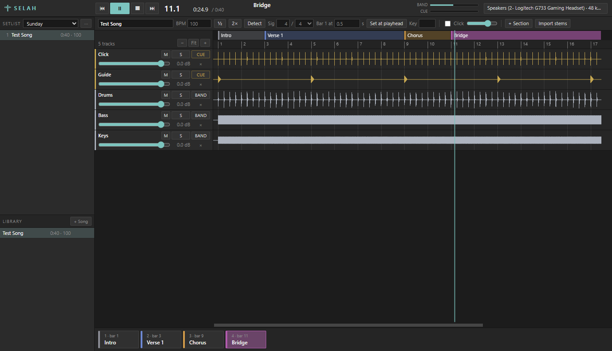

# Selah BETA

Multitrack playback for live worship, built to replace Ableton on stage.
Import a song's stems, set its tempo, mark its sections, send click and guide
to the in-ears and the band tracks to the mains, and jump between sections on
the bar line with a spoken count.



## Install

### Mac with Apple Silicon (M1 or newer): the app

1. Open the [Releases](../../releases) page and download
   `Selah-BETA-mac-arm64.zip` from the newest release.
2. Double-click the zip, then drag **Selah BETA** into your Applications
   folder.
3. Open it. macOS will refuse the first time, because the app is not signed
   with an Apple Developer account. Open **System Settings → Privacy &
   Security**, scroll down, and click **Open Anyway**. You only do this once.
4. Selah asks for a key. Type the one you were given. It is asked once per
   computer.

That is the whole install. Nothing else needs to be set up.

### Intel Mac or Windows: from source

You need [Node.js](https://nodejs.org) 22.12 or newer. Then, in a terminal:

```bash
git clone https://github.com/Shanetabr/selah.git
```

```bash
cd selah
```

```bash
npm install
```

```bash
npm start
```

`npm install` also fetches the audio module for your computer, so run it on
the computer you will use; do not copy the `node_modules` folder from another
one.

## Keys

Selah asks for a key the first time it starts on a computer. There are two.
The basic key opens Selah. The full key opens Selah with one more click sound
that is only for the people it was given to; that sound is stored sealed and
cannot be opened without the full key. Settings shows which key a copy has
and takes another one.

## Your first song

1. Press **Open…** (or drag a folder onto the window) and choose a folder of
   stems. Selah makes a song with one track per stem. If there is a click
   stem, it reads the tempo from it.
2. Press **Audio…** and pick your output device. For a quick try, the Mac's
   own speakers or headphones are fine.
3. Double-click the strip above the bar numbers to add sections, or open an
   Ableton cue clip (MIDI) to get them all at once.
4. Press Space to play. Tap a section's pad to jump there: Selah says the
   section's name, counts, and lands on the bar line.
5. Switch to **LIVE** for a service: nothing can be edited by accident.

## Build the app yourself

```bash
npm run build:mac
```

The app lands in `dist/Selah BETA-darwin-arm64/Selah BETA.app`. On Windows,
`npm run build:win`. Each has to be built on its own kind of computer,
because the audio module is different for each.

## For developers

```bash
npm test
```

```bash
npm run selftest
```

`npm test` runs the unit tests. `npm run selftest` drives the real app end to
end and plays quietly for about a minute; put `SELAH_SILENT=1` in front of it
to make no sound.

The code is under the MIT licence. The sounds in `assets/` are not: the guide
voice and the click sounds are there for Selah to play, not to be reused.

## Using it

1. **Add a song.** Drop what you have on the window, or pick it with
   **Open…** (Cmd+O):
   - *A folder of stems* becomes a song. The folder name is the song name and
     each file a track. Stems named click, guide or cues go to **EARS** (the
     in-ear mix); everything else to **MAINS** (front of house). The badge on
     each track switches it.
   - *Loose stems* are added to the open song.
   - *A cue clip* (a MIDI file exported from the Count In track of our Ableton
     sets) becomes a song with its tempo, time signature and every section,
     and the guide counts into each section the way the clip did. A folder of
     cue clips makes one song each, in the Library. A cue clip dropped while a
     song with stems is open can be that song's structure instead: Selah asks.
     A cue clip sitting in a folder of stems is used for that song.

   The tempo of a cue clip is read from its file name ("BE PRAISED - CUE 67",
   "PRAISE - CUE 127/2"). Words the clip says on their own, with no count
   ("All In", "Last Time"), come across as callouts.

   **Nothing is doubled by accident.** If what you bring in has the name of
   something already there (a song in the library, or a stem in the song),
   Selah says so and asks once: **Replace** brings the one you have up to date
   (a song takes the new stems or the cue clip's tempo and sections; a stem
   takes the new file and keeps its volume, mute and output), **Skip** leaves
   it as it is. In LIVE it always skips.
2. **Set the tempo.** Type the BPM and time signature, or press **Detect** to
   read them from the click or drum stem. The BPM counts quarter notes in
   every signature, as in Ableton. "Bar 1 at" is where the first downbeat sits
   in the audio; zoom in and check the bar lines against the waveform. Detect
   and "Bar 1 at" only appear on a song that has stems.
3. **Mark sections.** Put the playhead on a bar and press **+ Section**, or
   double-click the strip above the bar numbers. A new section runs to the
   next one, or splits the one it lands in. Then shape them in that strip:
   drag a block to move it, drag its right edge to make it longer or shorter
   (everything after follows), drag its left edge to move only its start.
   Blocks snap to bars (hold Option for beats) and never overlap: moving one
   right pushes the ones after it, moving left stops at the one before.
   Double-click to rename. Right-click a section's **pad** to turn it into
   another section in one click (Verse, Chorus, Bridge…), to set its guide or
   colour, or to delete it.
   Clicking a block does not move playback; the pads do that.
4. **Route the outputs.** Press the audio button (top right). Pick the device,
   then where MAINS and EARS go. "Ears 1, mains 2" is how the Ableton set was
   wired (click on output 1, everything else on output 2). With four outputs,
   "Ears 1, mains 3–4" keeps the in-ear cable where it is and gives the band a
   stereo pair.
5. **Play.** Tap a section pad (or press 1–9) while playing and Selah counts
   it in, "Chorus 2 3 4", then jumps on the bar line. The top bar shows what is
   queued and when; Esc, or a click on that readout, cancels. Tapping the pad
   again does not.
6. **Go LIVE for the service.** The switch at the top left reads **EDIT |
   LIVE**. In LIVE nothing can be edited, the setlist is fixed, the keyboard
   always controls playback, and the pads and the readout get bigger. Volume,
   mute and solo still work. Going back to EDIT asks first.

**No stems.** Library > + Song > Empty song (or Sample song to see one made).
Type the BPM and time signature, then mark the sections. Selah plays its click
and guide, the section pads fill the window, and the song grows instead of
stopping if you play past its end. Drop stems on it later and the same song
plays them too.

**Guide.** With **Guide** ticked, Selah's voice says each section's name and
counts it in, in the in-ears: two bars before the song ("Intro · 2 · 1 2 3 4")
and one bar before each section ("Verse 2 3 4"). If the first section is at bar
1, the count plays before the song starts, and the top bar says so. A strip
under the section blocks marks where the guide speaks. It starts switched off
on a song that has its own Guide stem.

**Click sounds.** Song settings has a list of click sounds: your own
(EW click), Blip, Classic, Cowbell, Digital, Gentle, Percussive, Saw,
Woodblock and the plain Beep. Choosing one plays two bars of it straight away,
in the open song's time signature and tempo and with its other click settings,
so you can listen your way down the list. The demo goes to EARS like the click itself,
does not move the song, stops when you close the window, and only plays while
the song is stopped; with the song running you hear the change as you make it.

**Song settings** (the button beside Guide) holds what is particular to one
song: whether it is a fast song counted at double speed, the click's sound,
pattern and speed, and the guide's level, speed and count-ins. Speed changes
only the click or only the guide; the song's tempo, bars and sections stay as
they are. On a fast song the button turns amber, because the guide's count
blurs at full speed.

**Settings** (the cog, top left) holds what applies everywhere: what new songs
start with, whether pausing holds its place or goes back to the start of the
song, what a song does at its end, whether a tap while stopped moves the
playhead or starts playing from that section's count-in, and **Confirm
delete**: on, Selah asks before a song, tracks or a setlist are deleted; off,
they go at once (Cmd+Z still brings back a song or tracks).

**A tap is always counted in.** While playing, the guide says "Chorus 2 3 4"
and the jump lands after that bar, one to two bars after the tap. This happens
on every song, including one whose own Guide is off because it has a recorded
guide stem, which cannot follow a jump. A section called Tag is the exception:
it is never announced, by the guide or on a tap, unless you give it a guide of
its own with a right-click on its pad.

**An unplanned song in LIVE.** Click it in the Library and it joins the end of
the setlist; then open it from there. Or press **Stems…** to open the stems
folder and drag a song's folder onto the window. The corner under the Library
shows which build of Selah is running.

**The end of a song.** The light line with a small grip at the end of the
timeline is where the song ends. Drag the grip, in the bar numbers, like the
edge of a clip in Ableton: to the left to cut the song short (it stops, or
hands over to the next song, at that bar), to the right to make it longer
(the click and the guide carry on after the audio). It snaps to bars; hold
Option for beats. Right-click the line, anywhere along it, to choose how
finely it snaps: 4 bars, 2 bars, 1 bar, 1 beat, or not at all. What lies
after the end is dimmed. Double-click the grip to
put the end back where the audio ends, and Cmd+Z undoes it. On a song with no
stems the same grip sets its length.

**Tempo from a click stem.** When a folder of stems includes a click stem
(named click, clk or metronome), Selah reads it and sets the song's tempo and
where bar 1 is, and says so in a note; Cmd+Z undoes it. The Detect button
does the same for a song already in the library.

**Separate channels.** For a desk that wants the click, the guide and the
tracks apart (a Dante rig with eight channels, say): in the audio settings
set Layout to "Separate channels". The click gets an output of its own, the
guide another, and the tracks go out in groups you name (Drums, Bass, Keys,
Guitars, Vocals, Other to start with), each on one output or a stereo pair.
Two buttons fill eight channels for you: click 1, guide 2, then six groups or
three stereo groups. Selah puts each track in a group from its stem's name;
the button on a track, which says MAINS or EARS in the two-feed layout, shows
its group and changes it. A recorded click stem goes to the click's output
and a guide stem to the guide's. On a device with only two outputs this layout is
silent apart from click and guide; switch back to "Two feeds" to rehearse on
headphones.

**Checking the outputs.** Audio settings has Check outputs: each output of
the device in turn says its number (a click from output 8 up), so you can
see at the desk which is which.

**Voice control (first try).** Press Voice in the top bar and say a section's
name: "chorus", "bridge", "verse". Selah does what a tap on that pad does,
count and all, and a note says what it heard. Say the name without its
number; "verse" goes to the next verse after the playhead. The bar along the
bottom of the button shows the microphone is hearing something. Pick the
microphone in Settings. It is off every time Selah starts, it listens on this
computer only, and it has not yet been tried with a band playing.

**Meters.** MAINS and EARS, above the track names, show what is going out.
Each track has its own thin meter along the bottom of its row: what that
track is putting out right now, after its volume, mute and solo.

**Levels.** Every level starts at 0 dB. Double-click any level slider (a track's volume, the click, the
guide, the output levels) to set it to 0 dB.

**From one song to the next.** Settings has "When a song ends": it stops
there, or lines up the next song in the setlist ready for Play, or rolls
straight into it. One song can do something different in its Song settings. A
song with stems ends where its audio ends; a song with no stems ends after its
last section when it is to hand over (set to stop, it has no end and keeps
going). The right of the top bar shows the next song's title, with its key
and tempo under it, and for the last eight bars it turns amber and counts
down: "Song change in 4 bars". The MAINS and EARS meters sit above the track
names.

While a song plays, a click on another song does not interrupt: that song is
**lined up**, and opens when this one ends or is stopped. **Fade** (or F) ends
a song early without a hard cut: everything fades over four seconds, then it
stops, and a lined-up song takes over.

**Callouts.** A callout is a word the guide says at one point of the song
that is not a section: "All In", "Build", "Last Time", "Hits", or a bare
"1 2 3 4" into a bar. Put the playhead where it belongs and press
**+ Callout**. Callouts show as a row of white chips under the pads, and on
the timeline as a white line with the word on a small flag (a triangle when
there is no room for the word); right-click a chip to change the word, move it to the
playhead or delete it. They follow the Guide switch, and are not said while a
tapped jump is waiting to land.

**Selecting tracks** works as it does for files in Finder. Click a track's
name to select it, Shift-click another to take everything in between, Cmd-click
to add or drop one. Then drag them up or down to reorder them (a line shows
where they will land), press Delete or a selected track's × to remove them all
(it asks first), or right-click to send them all to MAINS or to EARS. Esc, or a
click below the last track, clears the selection. There is no selecting in
LIVE.

**Selecting songs in the setlist** works the same way: Shift-click takes a
run, Cmd-click adds or drops one, then drag them together to reorder or press
× or Delete to take them all off the setlist (they stay in the library). A
plain click still opens the song. Cmd+Z undoes a setlist change.

**Undo.** Cmd+Z undoes a change to a song's setup: tempo, signature, settings,
sections, and the order of its tracks. It also brings back tracks you just
removed and a song you just deleted, until Selah is closed. Shift+Cmd+Z
redoes. Volume, mute and solo are not part of it.

| Key | Action |
| --- | --- |
| Space | Play / pause (or play / back to the start, if Settings says so) |
| Enter | Stop and rewind |
| 1–9, 0 | Jump to section 1–10 |
| ← / → | Previous / next section |
| F | Fade the song out and stop |
| Esc | Cancel a queued jump; clear the track selection |
| Delete | Remove the selected tracks (asks first) |
| Cmd/Ctrl + Z | Undo a change to the song's setup, removed tracks, or a deleted song (Shift to redo) |
| Home | Go to the start |
| Ctrl + scroll | Zoom the timeline |
| Shift + scroll | Scroll the timeline |

The strip of sections at the top is taller on a song with no stems, where
there is room: bigger names, each section's length under its name, and the
song opens zoomed in far enough to read them (Fit shows all of it).

While a song plays the timeline follows the playhead. Scroll or zoom it by
hand and it lets go, so you can look ahead; four seconds after you stop
scrolling it goes back to the playhead.

Everything saves automatically. Your setup lives in
`%APPDATA%\selah` on Windows and
`~/Library/Application Support/selah` on a Mac. Stem files stay
where they are and are never modified.

## What is done

Build-order steps 1 to 5:

1. **Audio engine.** Imports WAV, MP3, M4A, FLAC and OGG. All tracks play from
   one shared sample position, so they cannot drift. Volume, mute and solo per
   track.
2. **Song setup.** BPM and time signature per song, tempo detection, a
   generated click, real waveforms on a bar timeline, draggable section
   markers.
   Click-only songs with no stems. The click is either a generated beep or
   the sampled EW click on eighth notes. Spoken cues and count-ins are placed
   automatically from the section markers and follow live jumps.
3. **Output routing.** Two outputs, MAINS and EARS, each sent to any stereo pair or
   single output of the device. ASIO, WASAPI and DirectSound on Windows;
   CoreAudio on Mac.
4. **Section jumping.** Jumps land exactly on the next bar line with a short
   crossfade so the new downbeat is intact.
5. **Setlist.** A song library, multiple named setlists, reorder by dragging,
   all saved automatically. The next song in the setlist is preloaded so
   switching is immediate.

Around those: one **Open…** (and drop) for stems, folders of stems and the
Ableton cue clips, which become songs with their tempo and sections; EDIT and
LIVE modes; undo for a song's setup, removed tracks and deleted songs;
selecting several tracks to reorder, re-route or remove them; a right-click on
a section's pad to change, silence or delete it.

## How it was tested

- `npm test`: 95 unit tests on the mixer, cue placement, section editing,
  sample loading, tempo detection and the reading of cue clips, including a sweep of the click and the
  cues through every time signature from 1/4 to 12/8, and a comparison of
  4/4, 3/4 and 6/8 against the note times in the Ableton set (sample alignment across block sizes, mute/solo, bus routing,
  click placement, bar-line jumps, cue timing, count-in, cues across a jump).
- `npm run selftest`: starts the real app, generates stems, imports them, plays
  them quietly on the real output and checks up to 89 things end to end,
  including mouse input on the timeline, a click-only song with its count-in,
  opening cue clips, replacing and skipping duplicates, callouts, the hand-over
  from song to song, selecting and removing tracks, the pad menu, and
  switching to a stereo-only device. `SELAH_SILENT=1 npm run selftest`
  runs the same checks while sending silence to the device. On Windows it was
  also run against the packaged build, and with a 14-stem, 5-minute song plus
  an MP3. The test window cannot take the keyboard or the mouse, so the
  computer can be used while it runs. Before 2026-10-05 it could, and a key
  pressed for another app now and then started or stopped playback mid-test
  and failed the run. Keep the lid open, though: a Mac with its lid shut
  stops taking audio, the test's playback stands still, and the test says so.

Not tested, so check these yourself:

- **By ear.** The tests measure signal levels and positions. The owner has
  listened to the click and the guide voice and steered them; the automated
  runs themselves are done with the output silenced.
- **Mac.** Runs from source on an Apple Silicon Mac: the unit tests and the
  self-test pass through CoreAudio on the built-in speakers, and the packaged
  `Selah BETA.app` passes the same self-test. No interface with more than two
  outputs has been tried, and the packaged app has not been opened on a second
  Mac.
- **ASIO and a real multi-output interface.** This PC has no ASIO driver.
  Routing was verified on a headset that reports 8 channels over WASAPI.
- **A full-length service** on the machine and interface you will use.
- **A few gestures by hand.** Dragging files onto the window, the Open
  dialog, dragging tracks to reorder them and right-clicking a pad are checked
  by the self-test through the same code, with made-up mouse events. The 11
  cue clips on the owner's Desktop were read with the app's own reader and
  compared word by word (847 of 876 identical with callouts); the owner
  dropped them in himself.

## Known limits

- **Recorded guide stems do not follow jumps.** A guide stem announces the
  original arrangement, so after a jump its cues can be wrong. Mute it and use
  Selah's own Guide, which does follow jumps.
- **A jump lands one to two bars after the tap**, because the full "Chorus 2
  3 4" has to fit first. Esc cancels a jump that is no longer wanted.
- **Type the same tempo Ableton shows.** In the Ableton sets this replaces,
  the click ticks eighth notes: at 72 it ticks 144 times a minute and the voice
  counts at 72. Selah at 72 does exactly that. Typing 144 doubles everything.
  For a fast song whose real bars go by at 144, type 72 and say Yes to "Fast
  song" in Song settings:
  it sounds the same, and bars, sections and jumps are counted at 144.
- **The voice knows about 40 section names** (Intro, Verse 1–6, Chorus 1–4,
  Pre Chorus 1–4, Bridge 1–4, Tag, Vamp and so on) and counts to 7. Any other
  name is counted in without being spoken.
- **3/4 and 6/8 follow the Ableton sets**, checked against their note times:
  - 3/4: the click is two groups of three eighths; the voice counts six,
    "1 2 3 4 5 6"; the song start and every section get two bars.
  - 6/8: the click has the main sound once a bar; the count-in is a bar of
    click and then "Intro · · 4 5 6"; sections get "Verse · · 4 5 6".
  Pick a different count-in in Song settings to override.
- **A cue clip comes across almost whole.** In the 11 clips tried, 847 of 876
  words are said at the same moment. The rest: a tag is kept silent and a
  Breakdown loses its count, both on purpose (a Breakdown is always a callout,
  never a section); a section name the clip says alone on a downbeat is said a
  beat early; and the old one-bar count in 3/4 ("Verse 2 3 4 5 6") is said as
  "Verse · · 4 5 6".
- **The voice counts to 7.** A bar with more beats is counted in bigger steps:
  9/8 in three, 12/8 in four.
- **The BPM box counts quarter notes in every signature**, as Ableton's does,
  so 6/8 at 70 means what it means in Ableton. The "BPM is" box, shown when
  the signature is not over 4, can switch it to dotted quarters.
- **Songs are held in RAM.** About 11.5 MB per minute for each stereo stem at
  48 kHz; a 14-stem, 5-minute song used 770 MB, and the next song is preloaded
  as well.
- **One tempo per song.** No tempo or time-signature changes inside a song.
- **A jump tapped in the last tenth of a second of a bar** lands one bar later,
  because that audio is already on its way to the device.
- **A sleeping Mac plays nothing.** Shut the lid, or let the Mac sleep, and
  macOS stops asking every app for audio: the song stands still, with no
  error. Selah's audio button turns red and says the device is not taking
  sound, and clears when it is running again. Whether a song carries on by
  itself after the lid is opened has not been tried yet. In a service, keep
  the lid open and the Mac on power.
- **A missing output is silent, on purpose.** If CUE is routed to outputs 3–4
  and today's device only has 1–2, the click is muted rather than sent to the
  mains. The audio button turns amber.
- **Switching songs is blocked while playing.** Stop first.
- **No installer and no real code signing yet.** The Mac app is signed ad hoc,
  so macOS asks before opening it on another machine.
